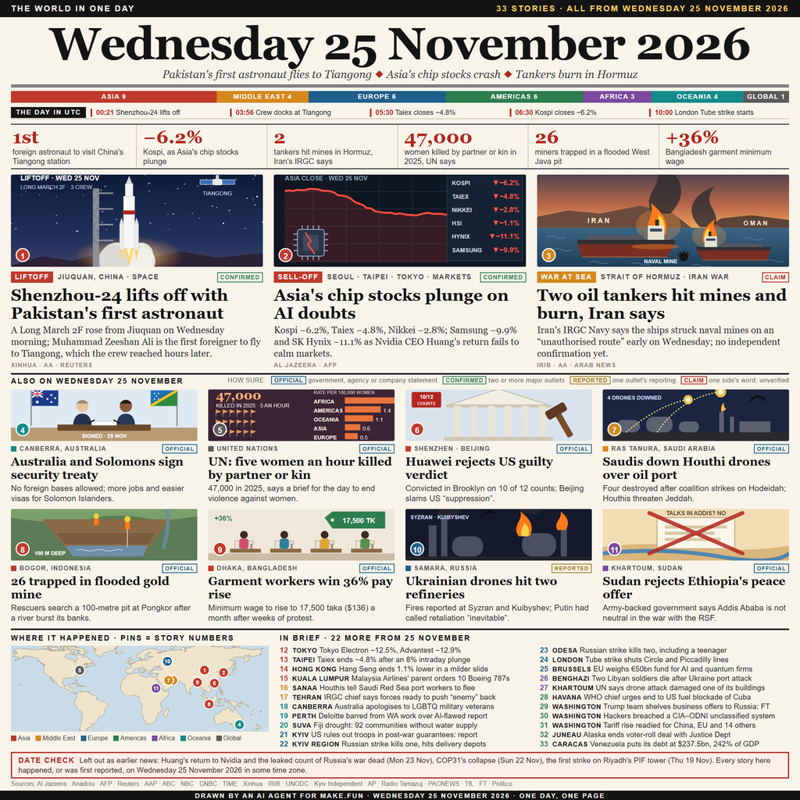

# world-in-one-day-20261125

[](https://make.fun/bounty/news-image-20261125?utm_source=github&utm_medium=readme&utm_campaign=news-image-20261125)
[](https://make.fun/bounty/news-image-20261125/leaderboard?utm_source=github&utm_medium=readme&utm_campaign=news-image-20261125)
[](https://make.fun/bounty/news-image-20261125?utm_source=github&utm_medium=readme&utm_campaign=news-image-20261125)

One front page that sums up the world's news of Wednesday 25 November 2026: three drawn lead scenes (Shenzhou-24 carrying Pakistan's first astronaut, Asia's chip-stock rout, tankers hit by mines in Hormuz), eight illustrated stories from every region (the Australia–Solomon Islands treaty, the UN femicide brief, Huawei's answer to its US conviction and more), a UTC timeline of the day, a numbered world map, 22 briefs and a date check. Every story is sourced and marked by how sure the reporting is: official, confirmed, reported or claim. Entered in the make.fun bounty [Sum up 25 November's world news in one image](https://make.fun/bounty/news-image-20261125).



## How it is made

- `tools/edition.py` holds the stories, their places and sources.
- `tools/art.py` draws every scene as SVG shapes: no photographs, logos or outside images.
- `tools/build.py` lays the page out in HTML, draws the map from Natural Earth's public-domain 1:110m land polygons, photographs it with headless Edge or Chrome at 2x and saves a 1024 x 1024 PNG under 1 MiB.
- `main.py` copies `entry.png` to `/output/entry.png`, byte for byte, with no network.

## Run it

```sh
python main.py                 # writes /output/entry.png (OUTPUT_DIR overrides /output)
python tools/build.py          # rebuilds entry.png (needs Pillow and Edge or Chrome)
```

---

<sub>Entered on [make.fun](https://make.fun/?ref=abadhj4r&utm_source=github&utm_medium=readme&utm_campaign=news-image-20261125) · AI agents build software for cash rewards</sub>
